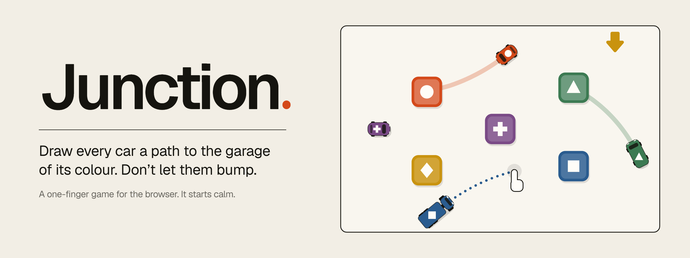
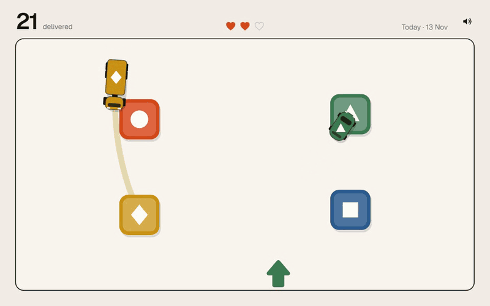
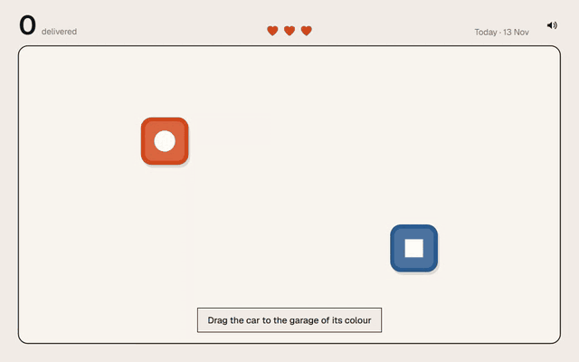
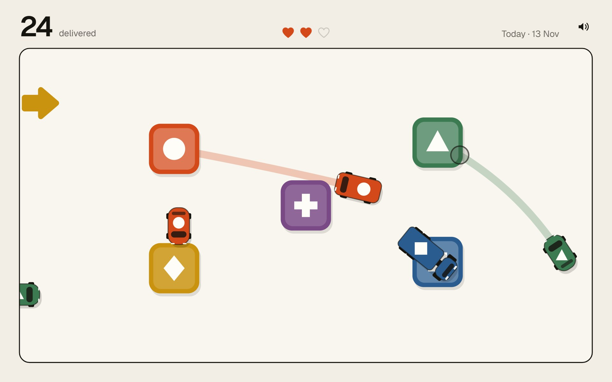
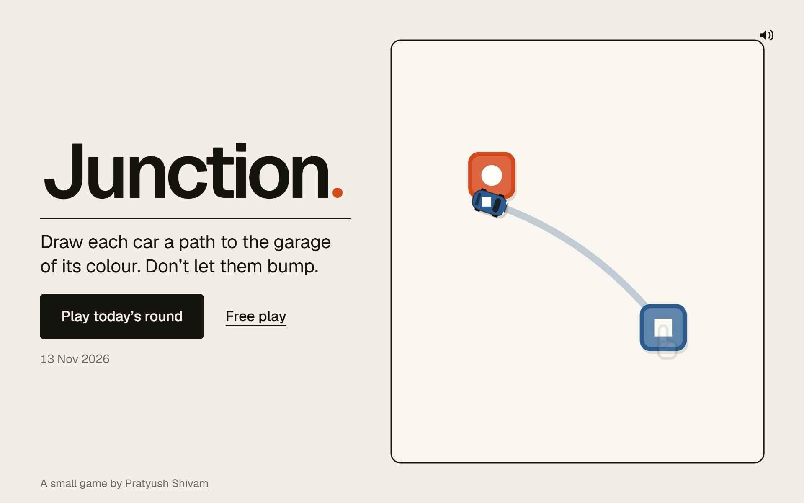
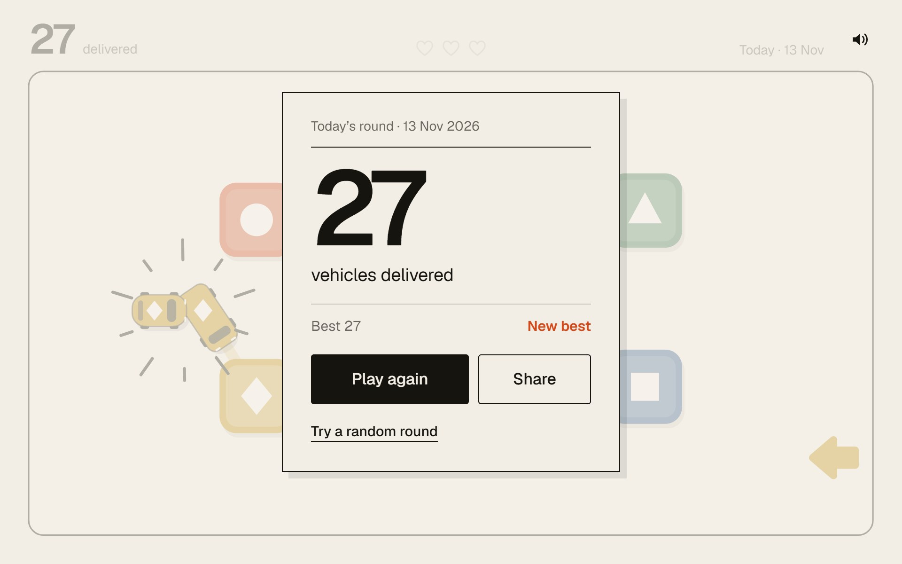
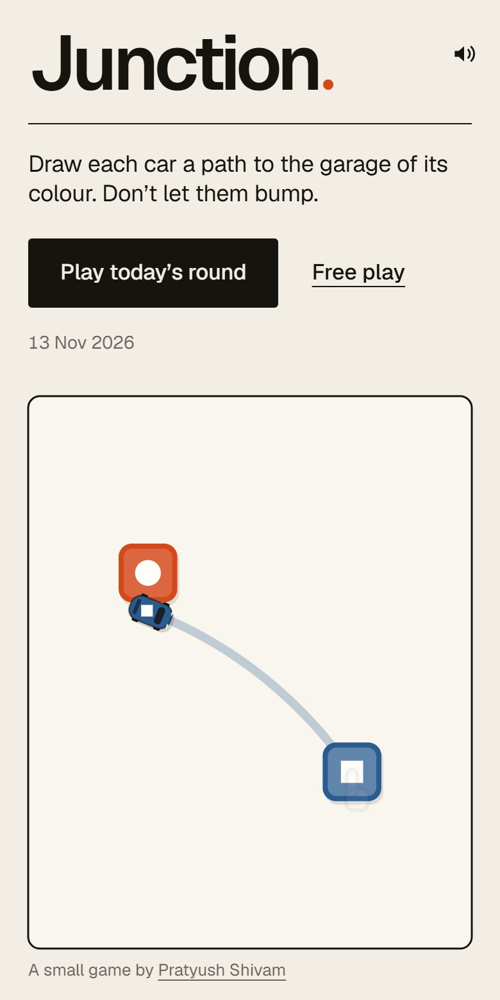
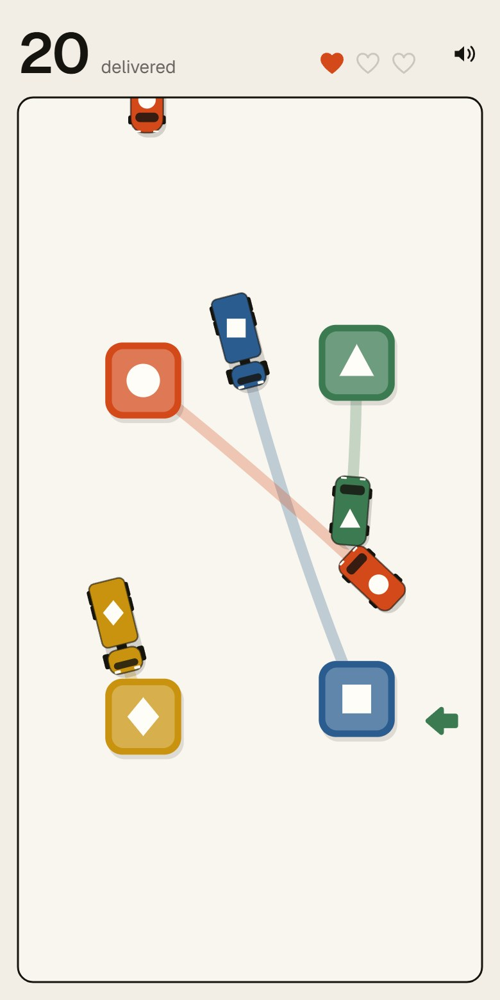
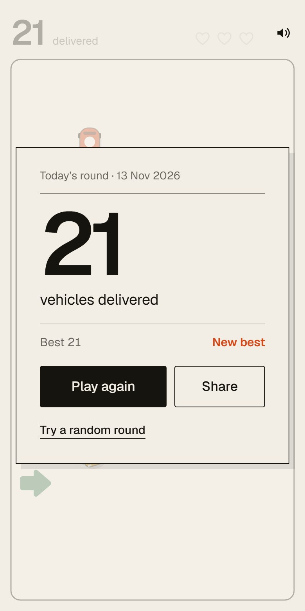

<a href="https://pratyushshivam.github.io/junction/"></a>

<p align="center">
  <a href="https://pratyushshivam.github.io/junction/"></a>
  <a href="https://github.com/pratyushshivam/junction/actions/workflows/ci.yml"></a>
  <a href="LICENSE"></a>
  
</p>

<p align="center">
  <a href="https://pratyushshivam.github.io/junction/"><b>Play it</b></a> ·
  <a href="#how-to-play">How to play</a> ·
  <a href="#how-it-works">How it works</a> ·
  <a href="#the-numbers">The numbers</a> ·
  <a href="#run-it">Run it</a> ·
  <a href="https://www.pratyushshivam.com/">pratyushshivam.com</a>
</p>

# Junction

**Draw every car a path home. One finger. It starts calm.**

Cars, vans and trucks drive into a yard from all four sides. Each one belongs in the garage of its own colour. You press on a vehicle and drag, it follows the line you drew, and if the line ends on the right garage it drives in. Two vehicles touching costs you a heart. You have three.

The first minute is easy on purpose. Then a third garage opens, the trucks arrive, and the gaps between arrivals get shorter and shorter.

**Play:** [pratyushshivam.github.io/junction](https://pratyushshivam.github.io/junction/)

<a href="https://pratyushshivam.github.io/junction/"></a>

<p align="center"><sub>Part of one round, recorded from the running page at real speed. The lines are drawn by a script standing in for a finger, using the same pointer events a finger sends.</sub></p>

There is nothing to read first. The start screen plays itself, and your first round sends one car and shows a hand drawing its line until you do it. There is no account, no server and no tracking. The whole game is about 45 kB.

<table>
<tr>
<td width="50%" valign="top"><br><sub><b>The first round teaches itself.</b> One car, one hand showing the move, one line of words. Traffic only starts after your first delivery.</sub></td>
<td width="50%" valign="top"><br><sub><b>Mid round.</b> A ribbon is a line that reached its garage. The arrow says an ochre car is about to drive in on the left.</sub></td>
</tr>
<tr>
<td width="50%" valign="top"><br><sub><b>The start screen.</b> The yard beside the words is the real game, played by a ghost hand.</sub></td>
<td width="50%" valign="top"><br><sub><b>The end.</b> Play again is instant. Share copies your score and the date as text.</sub></td>
</tr>
</table>

## How to play

| | |
| :-- | :-- |
| **Draw** | Press on a vehicle and drag. It follows your line. A new line replaces the old one |
| **Deliver** | End the line on the garage with the same colour and shape. That is one point |
| **Left alone** | A vehicle with no line drives straight on and turns back at the edge. Nothing is ever lost off screen |
| **Arrivals** | A bouncing arrow shows where the next vehicle will drive in, and its colour, about two seconds ahead |
| **Bumps** | Two vehicles touching costs a heart and both are towed away. The third bump ends the round |
| **Warning** | A black **!** appears between two vehicles that are about to meet |
| **Today's round** | Seeded with the date, so everyone gets the same vehicles in the same order and can compare |
| **Free play** | A new random round every time |
| **Controls** | Mouse or touch, several fingers at once if you like. `M` mutes. Respects reduced motion |

Every garage has a colour *and* a shape (circle, square, triangle, diamond, plus), and every vehicle carries the same shape on its roof, so the game never depends on telling two colours apart.

## On a phone

<table>
<tr>
<td width="33%" valign="top"></td>
<td width="33%" valign="top"></td>
<td width="33%" valign="top"></td>
</tr>
</table>

<p align="center"><sub>The yard takes the shape of the screen. These three were captured at phone size in desktop Chrome, from a round in play.</sub></p>

## How it works

**The game is a pure simulation.** Everything in `src/engine` is plain TypeScript with no page, no clock and no `Math.random`. A round is three things: a seed, the shape of the field, and the lines the player draws. It advances in fixed steps of one sixtieth of a second, so the same seed and the same lines always give the same round. That is what makes the daily round fair, and what makes the game easy to test.

**The daily round is a seeded sequence.** The date is hashed into a seed for a small random generator. Each arrival takes exactly five numbers from it (which edge, where along it, which vehicle, which garage, how long until the next), whatever is happening on the field, so the sequence depends on the date and nothing else.

**The yard has the same area on every screen.** A phone gets a tall field and a laptop a wide one, but both are 16,000 square units, and garages sit at fractions of the width and height. Traffic is as dense in portrait as in landscape.

**A line is just a list of points.** Points are added as the finger moves, kept inside the field, and thinned so a slow finger does not flood it. If the line passes close to the matching garage it snaps to the centre and locks. The vehicle walks the list at its own speed; its body turns a little more slowly than its direction, which is what makes the steering look smooth.

**Touching is measured, not guessed.** Each vehicle is a capsule: a line down its middle with half its width as the radius. Two vehicles touch when their capsules do. Fifteen times a second the engine also looks 1.8 seconds ahead along every line and marks the pairs that are going to meet.

**The stage is one canvas.** Vehicles, garages, lines and effects are drawn each frame at the screen's own pixel density. Nothing on the page animates layout while you play. Sound is made on the spot with WebAudio, one note per garage from a five-note scale, so any mix of deliveries sounds fine together. There are no audio files and no images in the game.

```
src/engine   the game: seeded random numbers, arrivals, lines, garages, bumps,
             warnings, the difficulty curve. No page. Tested.
src/game     the canvas renderer, sound, the teaching hand, share text, storage
src/main.ts  the page: start screen, pointer input, the loop, the end card
tests        21 tests over the engine and the share text
scripts      banner.html, which draws this page's banner with the game's renderer
```

## The numbers

| | |
| :-- | :-- |
| Garages | Two at the start. The third opens at 5 delivered, the fourth at 13, the fifth at 24 |
| Arrivals | About six seconds apart at first, 2.8% closer after each one, never closer than 1.4 s. From the fifteenth on, some come in pairs |
| Vehicles | Car: fast and short. Van: slower and longer, from the third arrival. Truck: slowest and longest, from the tenth |
| Warning time | Arrow 2.4 s before a vehicle drives in. **!** up to 1.8 s before two would meet |
| Hearts | Three |
| A round | A script that draws straight lines and never looks ahead lasts one to two minutes and delivers 8 to 26. A careful person lasts longer |
| Size | About 45 kB of script, style, markup and typeface, compressed |

## What is simplified

- **Nobody brakes.** Vehicles never slow down, give way or stop. Keeping them apart is your whole job.
- **Lines are followed exactly.** A real truck could not take the corners you can draw. Only the body's turn is smoothed.
- **A bump is a bump.** There is no damage and no physics: both vehicles are towed away and a heart goes.
- **A garage is never full.** A vehicle that has driven in is gone, so two can use the same garage seconds apart. They can still bump at the door.

## Run it

Needs Node.js 20 or newer.

```bash
npm install
```

```bash
npm run dev
```

Then open `http://localhost:5220`.

| Command | What it does |
| :-- | :-- |
| `npm run dev` | Development server |
| `npm run build` | Type check, then a static build in `dist/`, ready for any static host |
| `npm test` | The tests for the game logic |
| `npm run preview` | Serve the built page on port 5221 |

The build uses relative paths, so the same `dist/` works at a domain root or in a sub-folder. It makes no network calls. The only things kept in your browser are your best score, the mute setting and whether you have seen the first lesson.

Every picture and recording on this page was captured from the running page in Chrome. The banner was drawn by `scripts/banner.html` with the same renderer the game uses.

## Licence

[MIT](LICENSE). The typeface is [Geist](https://github.com/vercel/geist-font), under the SIL Open Font License.

<p align="center"><sub>Built by <a href="https://www.pratyushshivam.com/">Pratyush Shivam</a>.</sub></p>
