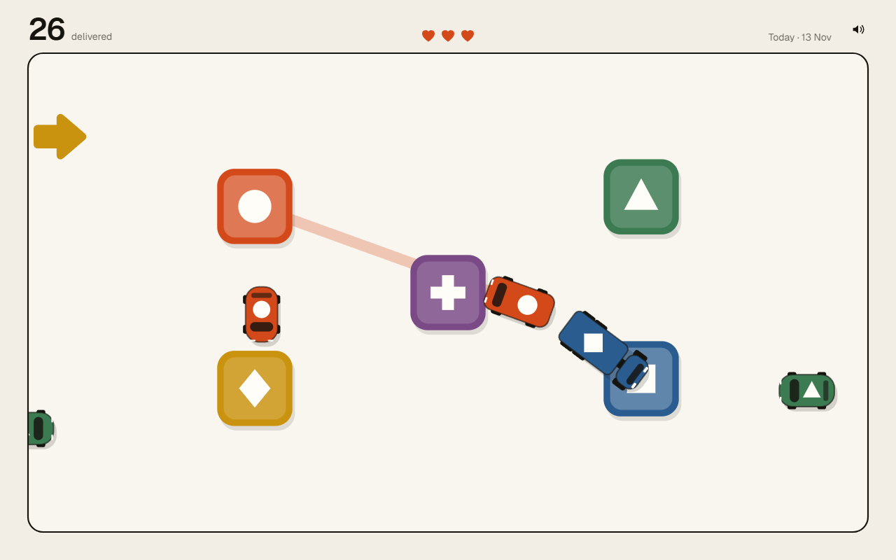
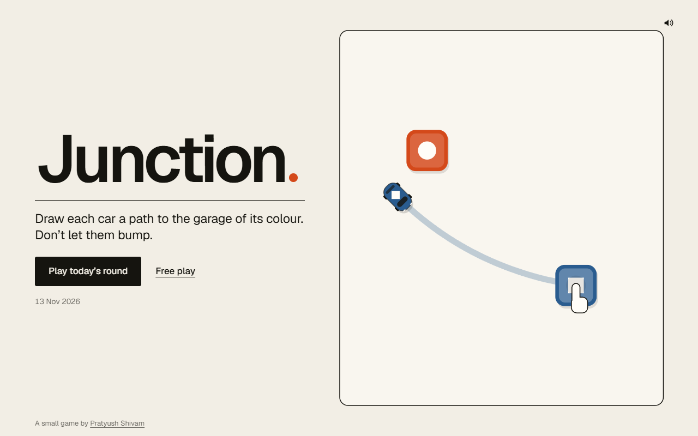
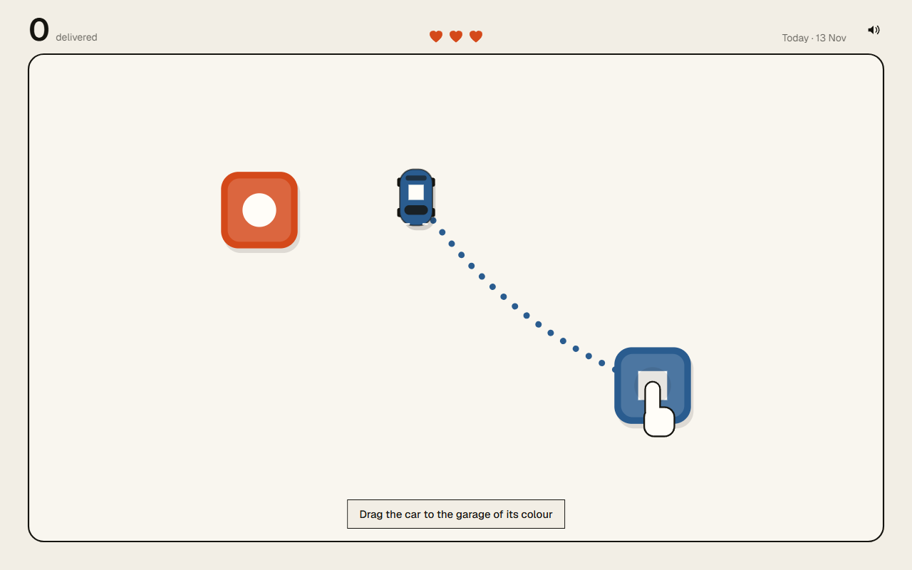
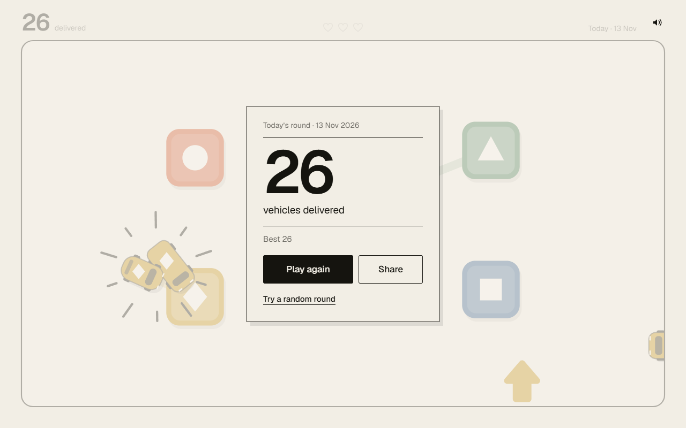

# Junction

A one-finger game for the browser. Cars, vans and trucks drive into a yard from every side. Draw each one a path to the garage of its colour, and don't let them bump. It starts calm and it does not stay calm.



## How to play

- Press on a vehicle and drag. It follows the line you draw.
- End the line on the garage with the same colour and shape. The vehicle drives in and you score one.
- A vehicle with no line keeps driving straight and turns back at the edge.
- An arrow at the edge shows where the next vehicle will drive in, and which colour it is.
- Two vehicles touching costs a heart. You have three.
- More garages open as your score rises, and the traffic gets faster.

**Today's round** is the same for everyone on the same date. **Free play** is a new random round each time. Share copies your score as text.

| Start | First round | Game over |
| --- | --- | --- |
|  |  |  |

## Run it

```bash
npm install
npm run dev
```

Then open http://localhost:5220. Other commands:

```bash
npm test
npm run build
npm run preview
```

The build is a plain static page in `dist/`. It needs no server, makes no network calls and stores only your best score and mute setting in the browser.

## How it is built

- **`src/engine`** is the whole game as a pure TypeScript simulation: no DOM, no clocks, no `Math.random`. A round is a seed, a field shape and the lines the player draws, advanced in fixed steps of 1/60 s. The daily round seeds the generator from the date, so the same vehicles arrive in the same order for everyone.
- **`src/game`** draws that simulation on a 2D canvas, turns pointer events into lines, and makes every sound with WebAudio (there are no audio files).
- **`tests`** cover the engine with vitest: the same seed replays the same round, a drawn line delivers, vehicles that meet bump, nothing leaves the field, and the difficulty rises.

The field keeps the same area whatever the screen shape, and garages sit at fractions of its width and height, so the game plays the same in portrait on a phone and in landscape on a laptop.

Every garage has a colour and a shape, so the game does not rely on colour alone.

## Licence

MIT. The typeface is [Geist](https://github.com/vercel/geist-font), used under the SIL Open Font License.
